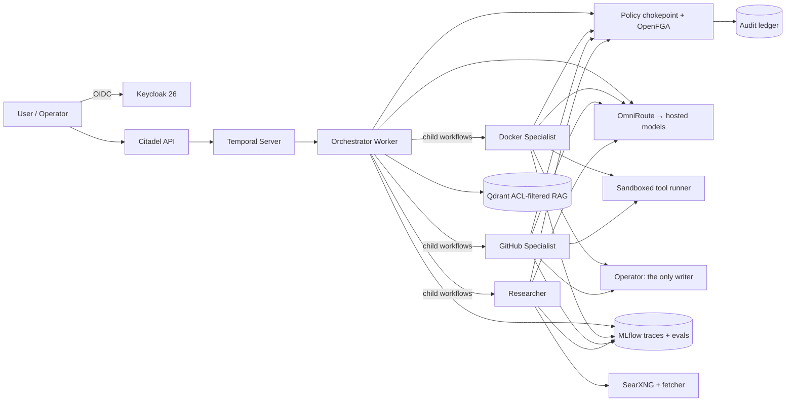

# Citadel

**A zero-trust agentic runtime for homelab DevOps — built as a reference architecture, not a demo toy.**

Citadel is a clean-slate Python + Docker Compose stack that runs a small fleet of specialised agents (Docker, GitHub, Researcher) against a real homelab. It treats identity, tenancy, authorisation, sandboxing, DLP, audit and evaluation as first-class runtime properties rather than middleware added at the end. It is a portfolio piece aimed at senior AI-engineering roles and is deliberately usable outside the demo.

**Status: v0.2 complete, with exit reviews in `docs/exit-review-v0.1.md` and `docs/exit-review-v0.2.md`.** Identity, policy, orchestration, sandboxing, the write path, DLP, the approval console, hash-pinned skill packs, the model loop and the API are built and verified on a live host. v0.2 adds permission-aware Qdrant retrieval, the Researcher specialist and SOPS+age secrets. Retrieval is built and tested but not yet called by a workflow (D1 in the v0.2 exit review). A task posted to `POST /runs` runs the whole v0.1 chain: pack plus tool manifest as the system prompt, a model call, the requested tool through the policy chokepoint and DLP gates, and the answer on `run.end`. See the [open issues](https://github.com/glaborie/citadel/issues) for known work, `docs/implementation-notes/v0.1-verification.md` for the v0.1 drills and `docs/exit-review-v0.2.md` for what v0.2 proved.

## What demonstrates what

The table is the architecture; the **Status** column says which rows exist as code today.

| # | Capability | Where it lands | Status |
|---|---|---|---|
| 1 | Authentication and identity propagation | Keycloak 26 OIDC; short-lived delegated per-run tokens | built |
| 2 | Multi-tenancy | Mandatory tenant claim → Postgres RLS, per-tenant Qdrant collections, cache partitions | built (RLS and per-tenant Qdrant); cache partitions are v0.3 |
| 3 | Tool calling with RBAC | OpenFGA policy decisions at a single `authorize()` chokepoint | built |
| 4 | Sandboxing | Hardened ephemeral sidecar; gVisor `runsc` as a one-line upgrade | built, without gVisor (`runsc` unavailable on this host) |
| 5 | DLP | Local Presidio + custom CH/EU recognizers; fail-closed; redact before egress | built |
| 6 | Guardrails | Inline policy checks on prompts, retrieval, tool args and model output | tool args, results, model input/output and retrieval chunks gated; policy done |
| 6a | Skills | Three hash-pinned packs with a lazy index; a run's `prompt_pack_version` must match the deployed pack | built: content, verified loader, checked provenance; the model loop assembles the pack |
| 7 | Human in the loop | Keycloak-authenticated approval console resuming Temporal workflows | built: five views, PKCE SSO, CSRF, server-side authorisation |
| 8 | Idempotency | Durable hashed tool keys + Postgres unique constraint; effectively-once semantics | built |
| 9 | Telemetry | OTel spans to MLflow; hash-chained security audit log in Postgres | built: spans carry the audit event id; audit chain built |
| 10 | MCP support | Adapter seam only; consume external tools in a later milestone | seam only |
| 11 | Permission-aware RAG | ACL-filtered Qdrant hybrid retrieval → rerank → structured citations | built; the orchestrator's task run retrieves once and records citations in `run.end` |
| 11a | Web research | SearXNG + bounded trafilatura fetcher; no internal reach; `untrusted_external` label | built |
| 12 | Code mode | Deferred; only inside the sandbox, never in the worker | deferred |
| 13 | Trajectory evaluation | MLflow 3.x offline + online grading of full traces | deterministic offline harness, live recorder and OTLP export built; judge rubrics built and report-only |
| 14 | A2A | Adapter seam only; ecosystem judged too thin to build against | seam only |
| 15 | Semantic routing | Deterministic → embedding → complexity routing in v0.4 | v0.4 |
| 16 | Scoped caching | Exact then semantic, partitioned by tenant + entitlement + model version | v0.3 |

## What runs today

`make up` starts 24 Compose definitions, unwrapping secrets through SOPS first into
gitignored Docker-secret files under `secrets/` (never into a container
environment). It builds the reranker image on first use, because the model is
baked in at a pinned revision and never fetched at runtime. It does not build
the other images: use `make rebuild` after a pull, or the old image keeps
running. 22 services are long-running, 20 declare health checks and all 20 are
healthy; `openfga-migrate` and `mlflow-bootstrap` are one-shot. The offline suite
collects 800 tests: 765 pass and 35 skip as live-network or live-model cases. A
fresh clone installs and runs that suite; the live cases opt in with
`CITADEL_LIVE_TESTS=1` against the running stack.

Before the first `make up`, copy `.env.example` to `.env` (gitignored) and fill
in `DOCKER_GID` with the host's docker group id:
`getent group docker | cut -d: -f3` (or `stat -c '%g' /var/run/docker.sock`).
Compose injects it as `group_add` on `operator` so uid 10001 can reach the
socket; unset or empty renders `group_add: [""]` and `docker compose up` stops
with `unable to find group : no matching entries in group file`, an error that
names no variable. Every checkout and worktree needs its own `.env`; see the
comment in `.env.example`.

| Control | Evidence |
|---|---|
| Identity | Keycloak login → delegated run token bound to tenant, user and run; child workflows get a scoped token, never the user's |
| Tenancy | `POST /runs` without a tenant claim is refused; RLS verified with the app role, which is not the table owner |
| Policy | One `authorize()` chokepoint against OpenFGA; unknown tools, T2 tools and cross-agent requests deny by default |
| Sandbox | `cap_drop: ALL`, read-only rootfs, no socket, egress only to `api.github.com` through a domain-allowlisted proxy |
| DLP | Presidio plus deterministic credential rules; person names are redacted after a filter that keeps the stack's own vocabulary readable; a detector that cannot answer blocks the call rather than passing text |
| Retrieval | Per-tenant Qdrant collections, ACL inside the Qdrant request, RRF fusion and TEI rerank; tenant-pairing tests and `RT-AUTHZ-01` |
| Research | SearXNG plus the trafilatura fetcher only; internal/metadata targets and inward redirects refused; `untrusted_external` and `prompt_injection` labels |
| Secrets | SOPS+age ciphertext tracked; provisioning into Docker secret files; custody test and live sweep of every named surface |
| Writes | `restart_service` and `open_remediation_pr` only, only from the operator, only with a single-use approval reference naming the exact arguments |
| Skills | `skills/<agent>/` index plus references, every file pinned by sha256; a changed, missing or unpinned file is refused at load, and `POST /runs` rejects a pack version the deployment does not have |
| Console | Five server-rendered views behind Keycloak PKCE login; a decision POST forwards to the API with the approver's own token, so CSRF, role and DLP checks stay server-side |
| Audit | Append-only hash chain per tenant, verified after every live drill |
| Tracing | OTLP/HTTP into MLflow; one T1 run produced a single trace with run start, policy, approval, three DLP events, tool call and run end, each carrying its audit ID |

### Tools

| Tool | Tier | Where it runs |
|---|---|---|
| `inspect_containers`, `get_service_health` | T0 | sandbox, read-only Docker proxy |
| `read_logs` | T0 | sandbox, `docker logs` on the container derived from the service name |
| `get_pr_status` | T0 | sandbox, `gh` over the egress proxy |
| `search_web` | T0 | researcher worker, SearXNG |
| `fetch_page` | T0 | researcher worker, trafilatura fetcher |
| `restart_service` | T1 | operator, approval-gated |
| `open_remediation_pr` | T1 | operator, approval-gated, draft PR from an existing branch |
| `search_code` | T0 | authorisable, no command mapping yet |
| `delete_volume`, `force_push` | T2 | always denied |

## Architecture

See `docs/architecture.md` for the full component view, request lifecycle, threat model and Compose topology.



## Milestones

- **v0.1** — one full turn: auth → tenant → policy → guarded read → HITL-gated write → audit + trace. *Complete: exit review in `docs/exit-review-v0.1.md`; all ten implementation steps delivered, four of five exit criteria met as written and the fifth recorded as a deviation.*
- **v0.2** — permission-aware RAG, Researcher, SOPS+age secrets. *Complete: exit review in `docs/exit-review-v0.2.md`; retrieval is built and tested but not yet called by a workflow (D1).*
- **v0.3** — full evaluation suite, online grading, tenant-scoped cache.
- **v0.4** — MCP consume adapter, A2A seam, code mode, semantic routing.

Details and exit criteria: `docs/milestones.md`.

## Deliberate non-goals

No local GPU inference. No multi-tenant SaaS control plane. No fine-grained billing. No general-purpose agent marketplace. No reversible DLP token vault in v0.1. No trusting OmniRoute's cache, idempotency or admin interfaces as security controls. See `docs/adr/ADR-001.md` and `docs/architecture.md`.

## Repository layout

```
README.md
SECURITY.md                   # how to report a vulnerability, and what is in scope
AGENTS.md                     # handover spec for the implementing agent
docs/architecture.md          # components, lifecycle, threat model
docs/milestones.md            # scope and exit criteria
docs/exit-review-v0.1.md      # v0.1 exit review
docs/exit-review-v0.2.md      # v0.2 exit review
docs/implementation-notes/    # what was executed and what it printed
docs/security/tool-tiers.md             # tool classification and approval flow
docs/security/citadel-threat-model.md   # trust boundaries and abuse paths
docs/security/llm-top10-mapping.md      # OWASP LLM Top 10 coverage
docs/operations/              # runbooks: start a run, CLI, host firewall
docs/evals/trajectory-schema.md
docs/adr/                     # 23 ADRs and an index
.sops.yaml                    # age recipient for the tracked secret file
secrets/citadel.env           # SOPS ciphertext; plaintext is never tracked
compose.yaml                  # 24 Compose definitions, images pinned by digest
Dockerfile                    # app / operator / sandbox / fetcher, one pinned base
docker/reranker.Dockerfile    # TEI plus the model, pinned by revision
Makefile                      # `make up` unwraps secrets through SOPS first
migrations/                   # RLS, tool ledger, audit chain, approvals
policy/                       # OpenFGA model + compiled JSON
evals/golden/                 # committed trajectories + expected outcomes
squid/github-egress.conf      # the sandbox's only egress allowlist
src/citadel/
  api/                        # runs, approvals, policy endpoints
  ui/                         # server-rendered approval console
  evals/                      # trajectory schema, deterministic graders, CLI
  identity/                   # Keycloak verification, run tokens
  policy/                     # catalog, OpenFGA checker, authorize()
  retrieval/                  # ingest, hybrid query, rerank, citations
  research/                   # SearXNG client, bounded fetcher, labels
  tools/                      # allowlist, argv builder, sandbox, operator
  workflows/                  # orchestrator + specialist workflows, activities
  dlp.py                      # fail-closed DLP (Presidio + hard rules)
  skills.py                   # hash-verified skill pack loader
  audit.py                    # hash-chained ledger
  telemetry.py                # one MLflow trace per run, spans carry audit IDs
  worker.py                   # role-scoped Temporal workers
tests/                        # 765 hermetic tests + opt-in live suites
```

## Verification status

Design reviewed and confirmed by the human owner on 2026-11-23. Implementation is verified against a real host: 22 long-running services, 20 with health checks and all 20 healthy; live Keycloak login, real OpenFGA decisions, real Postgres RLS, real GitHub reads, a draft-PR write that reached GitHub's `createPullRequest` mutation, and a DLP block that redacted a planted Swiss IBAN and refused a planted token. v0.2 adds the tenant-pairing retrieval tests, the citation validator, the recorded secret-surface sweep and a regenerated red-team report (31/35, 0 failing); retrieval is built, tested and called by the orchestrator's task run (D1 closed by #183).

Nothing in `docs/` is treated as done on paper: every control above has a recorded drill in `docs/implementation-notes/v0.1-verification.md` or `docs/exit-review-v0.2.md`, including the ones that failed first. The eval harness grades 14 cases (155/155 checks), and the T1 run's MLflow trace carries the policy, DLP, approval and tool spans with matching audit IDs. Open verification items inherited from the design (exact OmniRoute image commit, MLflow auth wiring, gVisor availability) are tracked in `AGENTS.md`; the OmniRoute and MLflow image questions are answered, MLflow's human-path auth remains open because the UI is not published, and `runsc` is documented as unavailable on this host with the Compose flags as the actual isolation boundary.
