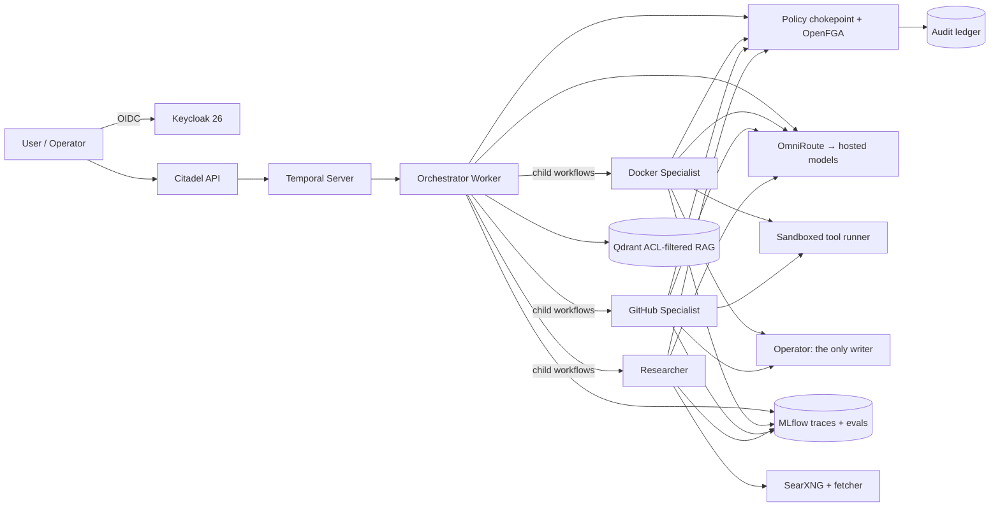

# Citadel

**A zero-trust agentic runtime for homelab DevOps — built as a reference architecture, not a demo toy.**

Citadel is a clean-slate Python + Docker Compose stack that runs a small fleet of specialised agents (Docker, GitHub, Researcher) against a real homelab. It treats identity, tenancy, authorisation, sandboxing, DLP, audit and evaluation as first-class runtime properties rather than middleware added at the end. It is a portfolio piece aimed at senior AI-engineering roles and is deliberately usable outside the demo.

**Status: v0.1 in progress — 9 of 10 implementation steps complete and running on a live host.** The identity, policy, orchestration, sandbox, write-path, DLP and model-gateway controls are implemented and verified end to end; the offline evaluation harness, live trajectory recorder and OTLP trace export to MLflow are built, and a T1 drill produced one trace with policy, DLP, approval and tool spans. The approval console's five views and Keycloak SSO are built (verified at the unit level, not yet against a live Keycloak). The remaining step is the red-team close-out and milestone exit review. See `TODO.md` for open work and `docs/implementation-notes/v0.1-verification.md` for what was executed, on which host, and what it printed.

## What demonstrates what

The table is the architecture; the **Status** column says which rows exist as code today.

| # | Capability | Where it lands | Status |
|---|---|---|---|
| 1 | Authentication and identity propagation | Keycloak 26 OIDC; short-lived delegated per-run tokens | built |
| 2 | Multi-tenancy | Mandatory tenant claim → Postgres RLS, per-tenant Qdrant collections, cache partitions | built (RLS); Qdrant is v0.2 |
| 3 | Tool calling with RBAC | OpenFGA policy decisions at a single `authorize()` chokepoint | built |
| 4 | Sandboxing | Hardened ephemeral sidecar; gVisor `runsc` as a one-line upgrade | built, without gVisor (`runsc` unavailable on this host) |
| 5 | DLP | Local Presidio + custom CH/EU recognizers; fail-closed; redact before egress | built |
| 6 | Guardrails | Inline policy checks on prompts, retrieval, tool args and model output | tool args, results and policy done; model/retrieval paths do not exist yet |
| 6a | Skills | Three hash-pinned packs with a lazy index; a run's `prompt_pack_version` must match the deployed pack | built: content, verified loader and checked provenance; no runtime assembles the prompt yet |
| 7 | Human in the loop | Keycloak-authenticated approval console resuming Temporal workflows | built: five views, PKCE SSO, CSRF, server-side authorisation |
| 8 | Idempotency | Durable hashed tool keys + Postgres unique constraint; effectively-once semantics | built |
| 9 | Telemetry | OTel spans to MLflow; hash-chained security audit log in Postgres | built: spans carry the audit event id; audit chain built |
| 10 | MCP support | Adapter seam only; consume external tools in a later milestone | seam only |
| 11 | Permission-aware RAG | ACL-filtered Qdrant hybrid retrieval → rerank → structured citations | v0.2 |
| 12 | Code mode | Deferred; only inside the sandbox, never in the worker | deferred |
| 13 | Trajectory evaluation | MLflow 3.x offline + online grading of full traces | deterministic offline harness and live recorder built; MLflow export and judge rubrics pending |
| 14 | A2A | Adapter seam only; ecosystem judged too thin to build against | seam only |
| 15 | Semantic routing | Deterministic → embedding → complexity routing in v0.4 | v0.4 |
| 16 | Scoped caching | Exact then semantic, partitioned by tenant + entitlement + model version | v0.3 |

## What runs today

`make up` starts 17 services, unwrapping secrets through SOPS first so no plaintext copy is written to disk. All health-checked services report healthy; `./scripts/clean-clone-check.sh` installs and passes 265 tests (35 skipped: live-network and red-team executors not yet wired) from a fresh clone with no hidden files.

| Control | Evidence |
|---|---|
| Identity | Keycloak login → delegated run token bound to tenant, user and run; child workflows get a scoped token, never the user's |
| Tenancy | `POST /runs` without a tenant claim is refused; RLS verified with the app role, which is not the table owner |
| Policy | One `authorize()` chokepoint against OpenFGA; unknown tools, T2 tools and cross-agent requests deny by default |
| Sandbox | `cap_drop: ALL`, read-only rootfs, no socket, egress only to `api.github.com` through a domain-allowlisted proxy |
| DLP | Presidio plus deterministic credential rules; person names are redacted after a filter that keeps the stack's own vocabulary readable; a detector that cannot answer blocks the call rather than passing text |
| Writes | `restart_service` and `open_remediation_pr` only, only from the operator, only with a single-use approval token naming the exact arguments |
| Skills | `skills/<agent>/` index plus references, every file pinned by sha256; a changed, missing or unpinned file is refused at load, and `POST /runs` rejects a pack version the deployment does not have |
| Console | Five server-rendered views behind Keycloak PKCE login; a decision POST forwards to the API with the approver's own token, so CSRF, role and DLP checks stay server-side |
| Audit | Append-only hash chain per tenant, verified after every live drill |
| Tracing | OTLP/HTTP into MLflow; one T1 run produced a single trace with run start, policy, approval, three DLP events, tool call and run end, each carrying its audit ID |

### Tools

| Tool | Tier | Where it runs |
|---|---|---|
| `inspect_containers`, `get_service_health` | T0 | sandbox, read-only Docker proxy |
| `read_logs` | T0 | sandbox, `docker logs` on the container derived from the service name |
| `get_pr_status` | T0 | sandbox, `gh` over the egress proxy |
| `restart_service` | T1 | operator, approval-gated |
| `open_remediation_pr` | T1 | operator, approval-gated, draft PR from an existing branch |
| `search_code` | T0 | authorisable, no command mapping yet |
| `delete_volume`, `force_push` | T2 | always denied |

## Architecture

See `docs/architecture.md` for the full component view, request lifecycle, threat model and Compose topology.



## Milestones

- **v0.1** — one full turn: auth → tenant → policy → guarded read → HITL-gated write → audit + trace. *In progress: steps 1–7 of 10 done, offline eval harness, recorded trajectories and MLflow tracing in place.*
- **v0.2** — permission-aware RAG, Researcher, SOPS+age secrets.
- **v0.3** — full evaluation suite, online grading, tenant-scoped cache.
- **v0.4** — MCP consume adapter, A2A seam, code mode, semantic routing.

Details and exit criteria: `docs/milestones.md`.

## Deliberate non-goals

No local GPU inference. No multi-tenant SaaS control plane. No fine-grained billing. No general-purpose agent marketplace. No reversible DLP token vault in v0.1. No trusting OmniRoute's cache, idempotency or admin interfaces as security controls. See `docs/adr/ADR-001.md` and `docs/architecture.md`.

## Repository layout

```
README.md
AGENTS.md                     # handover spec for the implementing agent
TODO.md                       # open work, next item first
docs/architecture.md          # components, lifecycle, threat model
docs/milestones.md            # scope and exit criteria
docs/implementation-notes/    # what was executed and what it printed
docs/security/tool-tiers.md
docs/evals/trajectory-schema.md
docs/adr/                     # 23 ADRs and an index
compose.yaml                  # 17 services, images pinned by digest
Dockerfile                    # one file, three targets: app / operator / sandbox
Makefile                      # `make up` unwraps secrets through SOPS first
migrations/                   # RLS, tool ledger, audit chain, approvals
policy/                       # OpenFGA model + compiled JSON
evals/golden/                 # committed trajectories + expected outcomes
squid/github-egress.conf      # the sandbox's only egress allowlist
src/citadel/
  api/                        # runs, approvals, policy endpoints
  ui/                         # server-rendered approval console
  evals/                      # trajectory schema, deterministic graders, CLI
  identity/                   # Keycloak verification, run tokens
  policy/                     # catalog, OpenFGA checker, authorize()
  tools/                      # allowlist, argv builder, sandbox, operator
  workflows/                  # orchestrator + specialist workflows, activities
  dlp.py                      # fail-closed DLP (Presidio + hard rules)
  skills.py                   # hash-verified skill pack loader
  audit.py                    # hash-chained ledger
  telemetry.py                # one MLflow trace per run, spans carry audit IDs
  worker.py                   # role-scoped Temporal workers
tests/                        # 265 hermetic tests + opt-in live suites
```

## Verification status

Design reviewed and confirmed by the human owner on 2026-11-23. Implementation is verified against a real host: 15 containers healthy, live Keycloak login, real OpenFGA decisions, real Postgres RLS, real GitHub reads and a draft-PR write that reached GitHub's `createPullRequest` mutation, and a DLP block that redacted a planted Swiss IBAN and refused a planted token.

Nothing in `docs/` is treated as done on paper: every control above has a recorded drill in `docs/implementation-notes/v0.1-verification.md`, including the ones that failed first. The eval harness grades two trajectories exported from live runs, and the T1 run's MLflow trace carries the policy, DLP, approval and tool spans with matching audit IDs. Open verification items inherited from the design (exact OmniRoute image commit, MLflow auth wiring, gVisor availability) are tracked in `AGENTS.md`; the OmniRoute and MLflow image questions are answered, MLflow's human-path auth remains open because the UI is not published, and `runsc` is documented as unavailable on this host with the Compose flags as the actual isolation boundary.
