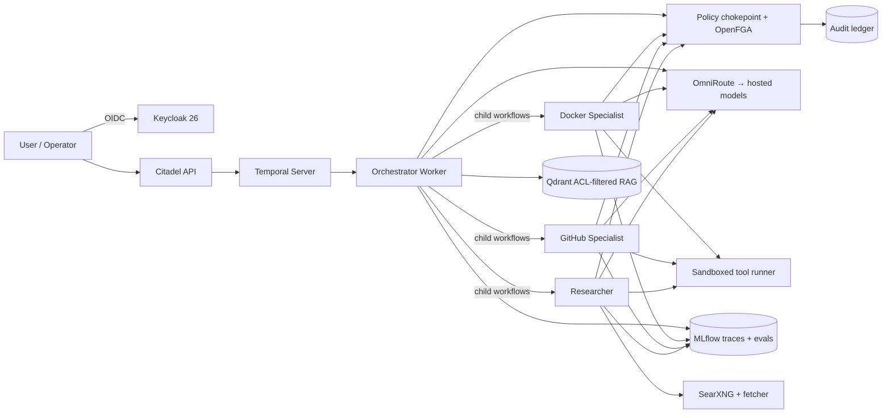

# Citadel

**A zero-trust agentic runtime for homelab DevOps — built as a reference architecture, not a demo toy.**

Citadel is a clean-slate Python + Docker Compose stack that runs a small fleet of specialised agents (Docker, GitHub, Researcher) against a real homelab. It treats identity, tenancy, authorisation, sandboxing, DLP, audit and evaluation as first-class runtime properties rather than middleware added at the end. It is a portfolio piece aimed at senior AI-engineering roles and is deliberately usable outside the demo.

**Status: design complete. No application code exists yet.** Implementation is handed to OpenCode from `AGENTS.md`.

## What it demonstrates

| # | Capability | Where it lands |
|---|---|---|
| 1 | Authentication and identity propagation | Keycloak 26 OIDC; short-lived delegated per-run tokens |
| 2 | Multi-tenancy | Mandatory tenant claim → Postgres RLS, per-tenant Qdrant collections, cache partitions |
| 3 | Tool calling with RBAC | OpenFGA policy decisions at a single `authorize()` chokepoint |
| 4 | Sandboxing | Hardened ephemeral sidecar; gVisor `runsc` as a one-line upgrade |
| 5 | DLP | Local Presidio + custom CH/EU recognizers; fail-closed; redact before egress |
| 6 | Guardrails | Inline policy checks on prompts, retrieval, tool args and model output |
| 7 | Human in the loop | Bespoke Keycloak-authenticated approval console resuming Temporal workflows |
| 8 | Idempotency | Durable hashed tool keys + Postgres unique constraint; effectively-once semantics |
| 9 | Telemetry | OTel spans to MLflow; hash-chained security audit log in Postgres |
| 10 | MCP support | Adapter seam only; consume external tools in a later milestone |
| 11 | Permission-aware RAG | ACL-filtered Qdrant hybrid retrieval → rerank → structured citations |
| 12 | Code mode | Deferred; only inside the sandbox, never in the worker |
| 13 | Trajectory evaluation | MLflow 3.x offline + online grading of full traces |
| 14 | A2A | Adapter seam only; ecosystem judged too thin to build against |
| 15 | Semantic routing | Deterministic → embedding → complexity routing in v0.4 |
| 16 | Scoped caching | Exact then semantic, partitioned by tenant + entitlement + model version |

## Architecture

See `docs/architecture.md` for the full component view, request lifecycle, threat model and Compose topology.



## Milestones

- **v0.1** — one full turn: auth → tenant → policy → guarded read → HITL-gated write → audit + trace.
- **v0.2** — permission-aware RAG, Researcher, SOPS+age secrets.
- **v0.3** — full evaluation suite, online grading, tenant-scoped cache.
- **v0.4** — MCP consume adapter, A2A seam, code mode, semantic routing.

Details and exit criteria: `docs/milestones.md`.

## Deliberate non-goals

No local GPU inference. No multi-tenant SaaS control plane. No fine-grained billing. No general-purpose agent marketplace. No reversible DLP token vault in v0.1. No trusting OmniRoute's cache, idempotency or admin interfaces as security controls. See `docs/adr/ADR-001.md` and `docs/architecture.md`.

## Repository layout

```
README.md
AGENTS.md                     # handover spec for the implementing agent
docs/architecture.md
docs/milestones.md
docs/security/tool-tiers.md
docs/evals/trajectory-schema.md
docs/adr/ADR-Index.md
docs/adr/ADR-001.md ... ADR-021.md
.env.example                  # placeholders only
.gitignore
```

## Verification status

Design reviewed and confirmed by the human owner on 2026-11-23. Two third-party probes were lost to an API rate limit and replaced with direct source checks; the remaining open items (exact OmniRoute image commit, MLflow image pin, gVisor availability on the target host) are recorded as implementation-time verification tasks in `AGENTS.md`. Nothing in this repository has been executed or deployed.
