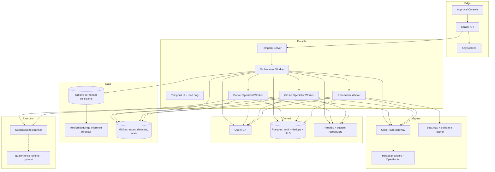
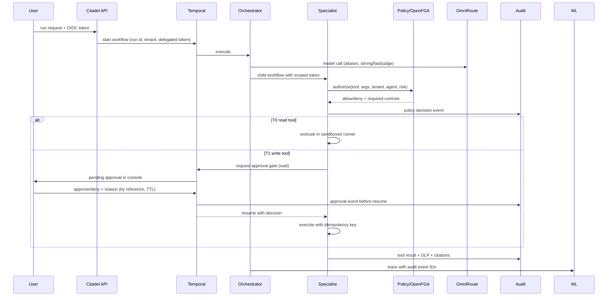

# Citadel Architecture

## 1. Purpose and constraints

Citadel is a Python + Docker Compose agent runtime for a homelab DevOps workload. It is portfolio-grade: every security control must be explainable, testable and demonstrably enforced, not merely documented.

Hard constraints settled in the design review:

- Clean-slate repository; prior projects contribute lessons only, not code.
- Portfolio/reference purpose, with real homelab utility; no paying client.
- Hosted inference only; no local LLM/GPU tier. Local CPU models are allowed only where data cannot leave the box (DLP).
- One canonical egress gateway; no application component holds a provider key.
- Multi-tenancy modelled from day one even though initial tenant count is one.
- Design/docs only in this phase; implementation is delegated later.

## 2. Component view

### Service responsibilities

- **Citadel API** — authenticated ingress, token validation, tenant extraction, run creation, approval console backend. FastAPI's schema endpoints (`/docs`, `/openapi.json`) are served only when the API's environment sets `CITADEL_EXPOSE_API_DOCS` (truthy value); they answer without authentication, so the default is off and `/redoc` is never served.
- **Temporal Server / UI** — durable state, retries, signals, child workflows, run history. UI is operator debugging only.
- **Workers** — one orchestrator plus specialist child workflows. Each specialist has its own tool manifest, OpenFGA relations, prompt/skill pack and model tier.
- **OpenFGA** — the single authorisation store. Answers tool-permission questions and supplies the filter set for retrieval.
- **Postgres** — append-only hash-chained audit events, tool idempotency records, tenant-scoped application data with RLS.
- **Presidio** — local DLP on ingress, retrieval chunks, tool args/results and model output; fail-closed.
- **Qdrant + reranker** — named dense and sparse vectors, payload ACL filters applied before search, RRF fusion, cross-encoder reranking.
- **OmniRoute** — provider abstraction, model aliases, fallback/quotas and cost headers only.
- **MLflow** — OTLP trace store, eval datasets, scorer results and comparison UI, behind a Keycloak OAuth2 proxy.
- **SearXNG + fetcher** — untrusted public-web research isolated from internal networks.
- **Sandboxed runner** — ephemeral, network-restricted container for tool execution and any future code mode.

## 3. Identity and tenant propagation

1. User authenticates to Keycloak 26 (OIDC). The token carries `sub`, tenant claim, roles and session ID.
2. Citadel API issues a short-lived **delegated agent token** per run carrying: user, tenant, agent identity, allowed scopes, risk tier and run ID. Keycloak RFC 8693 support has caveats, so the exact exchange mechanism is an implementation-time choice recorded in ADR-003; the token shape and propagation rule are not.
3. Every downstream component requires the token. Missing or malformed tenant/run claims fail closed.
4. Tool calls carry the delegated token plus a canonicalised argument hash. OpenFGA decides allow/deny; the decision is audited before execution.
5. Postgres RLS uses the tenant claim from the verified token, never a request parameter. Qdrant uses per-tenant collections. Cache partitions include tenant and entitlement hash.

## 4. Request lifecycle

Failure policy: DLP detector unavailable, a detector answer the reader cannot parse (a span missing a field, a non-numeric score, an offset outside the text), policy service unreachable, missing tenant claim, or malformed approval token all produce a **blocked run**, not a permissive fallback.

## 5. Specialist topology

- **Orchestrator** — owns conversation, planning, delegation and final response. Holds no direct side-effecting tools.
- **Docker specialist** — read-only host inspection; `restart_service` only as a T1 write.
- **GitHub specialist** — read repository/docs; `open_remediation_pr` only as a T1 write.
- **Researcher** — `search_web` and `fetch_page` only; produces cited findings and recommendations, never executes infrastructure actions.

Each specialist is a child workflow with its own versioned `SKILL.md` pack. Skills are documentation with progressive disclosure — an index first, full text on demand. They cannot declare tools, widen allowlists or override policy. Tool permissions live in OpenFGA and manifests.

The same holds for tool *metadata* from outside the catalog. A registry entry - an MCP server's `tools/list`, today the only such source - is data, not instruction: the name must already exist in the catalog, every field must be one this codebase knows, and the description's digest must match a reviewed pin in `description_pins.json`. A refusal is written to the ledger with the digest and never with the description, because an append-only log is not a place to copy attacker prose into. And the manifest the model sees carries no description field at all, so a description that passes review is still never obeyed - `citadel.tools.registration`, pinned by RT-INJ-06.

## 6. Retrieval path

1. Ingest filesystem runbooks/inventory and selected GitHub Markdown with content hashes and ACL metadata.
2. Embed via hosted embedding endpoint through OmniRoute; store dense + server-side BM25 sparse vectors in a per-tenant collection.
3. At query time, derive allowed resource filter from OpenFGA, apply it **inside** the vector query before reranking.
4. Fuse top results with RRF, rerank top 50 → top 8, redact per DLP policy, then generate with citations.
5. Citations are `(source_uri, revision, chunk_id, line_range)`. Operational recommendations without sufficient evidence must say so.

## 7. Sandbox and egress

Tool execution runs in an ephemeral sidecar: no egress by default, `cap_drop: ALL`, `no-new-privileges`, read-only rootfs, seccomp, pids/memory limits, per-invocation lifetime, no Docker socket, no inherited secrets. gVisor `runsc` is the approved one-line runtime upgrade. Docker Sandboxes (`sbx`) was rejected and uninstalled: proprietary, login-gated, host daemon outside Compose, 10–30 s startup and an agent allowlist. WASM cannot run general Python tools. `RestrictedPython`-style approaches are not security boundaries.

Researcher network access is via SearXNG + a trafilatura fetcher with size/MIME/time limits, no cookies, no internal targets, no cloud metadata addresses, and explicit `untrusted_external` labelling before content reaches a model. The two services sit on a dedicated `web` bridge (not `edge`) for egress and on an internal `research` network shared only with `worker-researcher`; neither publishes a port. The worker calls them directly, so the sandbox keeps its no-egress property.

## 8. Audit, telemetry and evaluation

Three distinct records, cross-referenced but never conflated:

- **Security audit** — append-only Postgres table, SHA-256 hash chain per tenant, every policy decision, DLP hit, redaction, retrieval, tool call, approval and model call.
- **Traces** — OTel spans exported to MLflow's OTLP/HTTP endpoint `/v1/traces` with `x-mlflow-experiment-id`. Each span carries the audit event ID.
- **Temporal history** — internal durable state; not an external audit source.
- **Metrics** — Prometheus exposition from the API and each worker, with bounded labels and aggregate values only ([metrics.md](architecture/metrics.md)); not a control.

MLflow stores versioned eval datasets and `mlflow.genai.evaluate()` results. Scorers see full traces: tool selection, argument accuracy, recovery, safety compliance and citation grounding. Offline CI grading uses recorded fixtures; online grading samples real runs into the same store.

## 9. Threat model summary

| Threat | Control |
|---|---|
| Stolen user token | Short-lived delegated token, tenant-bound scope, run ID, audit |
| Cross-tenant read | Mandatory tenant claim, RLS, per-tenant Qdrant collections, cache partition + red-team test |
| Tool authority escalation | OpenFGA chokepoint; skills cannot grant tools; deny by default |
| Unauthenticated tool call | Workers, `tool-runner` and the operator require a signed run token and authorise on its claims, so a network peer cannot write a policy decision, run a T0 command or drive the T1 writer as a tenant it holds no token for (ADR-027) |
| Prompt injection via retrieved/web content | Untrusted labelling, guardrail checks, Researcher cannot call infra tools |
| Secret exfiltration to hosted model | Local fail-closed DLP, credential masking, no secrets in sandboxes |
| Secret in a refusal message | The raw arguments are inspected before `build_argv`, so a rejected argument still meets the detector; refusals name the position and the class, never the value |
| Duplicate side effects on retry | Durable idempotency keys + Postgres unique constraint; documented crash window |
| Sandbox escape | No socket, no egress, dropped caps, gVisor upgrade; no host credentials in runner |
| Approval forgery | Keycloak RBAC, server-side authorisation, CSRF, TTL, signed reason, audit before resume, and `X-Frame-Options: DENY` plus CSP `frame-ancestors 'none'` on every console response - a framed decision form is a decoy click on a real approval |
| Agent approves its own run | The agent presents its own run token, must hold the OpenFGA `can_approve` relation, and is refused when it is the run's originating agent; the ledger records `actor_type=agent` and `on_behalf_of` (ADR-022) |
| Cache leak | Tenant + entitlement partition before similarity search, TTL, no T1/T2 caching |
| Sensitive data in the approval ledger | The `reason` is the one field a human types freely and the ledger is append-only, so it is gated on the `record` surface: PII is redacted in place, the redaction is counted and audited as `dlp.event`, a credential refuses the decision |
| Trace/prompt leakage to MLflow | Internal-only network, guarded by `tests/test_mlflow_exposure.py`; Keycloak proxy required before the UI is published; redaction before export |

## 10. Deployment topology (Compose, as built)

`api`, `approval-ui`, `temporal`, `temporal-ui`, `worker-orchestrator`, `worker-docker`, `worker-github`, `worker-researcher`, `keycloak`, `postgres`, `openfga`, `openfga-migrate`, `omniroute`, `presidio`, `mlflow`, `mlflow-bootstrap`, `qdrant`, `reranker`, `searxng`, `fetcher`, `tool-runner`, `operator`, `docker-socket-proxy`, `github-egress`. That is 24 default definitions, 22 long-running services, and 20 services with health checks (all healthy); `openfga-migrate` and `mlflow-bootstrap` are one-shot. The `ingest` one-shot is defined under the `tools` profile, so `make ingest` adds that definition only when invoked. Images are pinned by digest in `compose.yaml`.

Ingestion is a one-shot `ingest` service behind the `tools` profile: `make ingest TENANT=lab-a` reads `knowledge/` and the repositories named by `CITADEL_INGEST_REPOS` into that tenant's Qdrant collection, writing a dense vector from the configured embedding alias (after DLP redaction, so the hosted endpoint sees cleaned text) and a server-side BM25 sparse vector. It is the only service with the knowledge mount and the GitHub read token, and it reaches GitHub through the same allowlisted proxy as the sandbox.

The query half is `RetrievalActivities.retrieve` on the orchestrator worker: it builds the ACL filter from the subject's entitlement tags, sends the dense and sparse prefetches in one Qdrant request, fuses with RRF, redacts each candidate through DLP, reranks top 50 to top 8 with the in-stack TEI service, and writes `retrieval.query` / `retrieval.result` with a filter-set digest and citation metadata. The orchestrator's task run calls it once before the first model step, passes the run's tenant ACL tag, and puts the retrieved evidence and citation ids into the model context and `run.end.citation_ids` (D1 in `docs/exit-review-v0.2.md`, closed by #183).

The researcher services are in Compose: `worker-researcher` sits on an internal `research` network with `searxng` and `fetcher`, and on the `web` bridge for egress; none of the three publishes a port. Prometheus and Grafana are in the stack ([metrics.md](architecture/metrics.md)); Prometheus is internal-only, Grafana is loopback-only and requires a login.

Host exposure is two layers: the loopback binds above plus host `INPUT` drops on `eth0`/`tailscale0` for the four ports that were once published on `0.0.0.0`. The policy, its persistence across a reboot, and the drill that proves it are in [operations/host-firewall.md](operations/host-firewall.md).

## 11. Verification items (all resolved)

1. **OmniRoute upstream and image** — resolved: pinned by digest in `compose.yaml`; the redirect and fork question is documented in `docs/implementation-notes/v0.1-verification.md` §1.
2. **MLflow image and auth** — resolved: 3.18.0, pinned by digest, internal OTLP write path only (§19). Human-path auth stays open only if the UI is published (ADR-017).
3. **gVisor `runsc`** — resolved as documented fallback: unavailable on this host, so the hardened sidecar flags are the isolation boundary (ADR-012).
4. **Keycloak token exchange** — resolved in §5: standard exchange V2 preserves `sub`, `tenant` and roles but cannot carry the run claims, so the API mints its own Ed25519 run token. RFC 8693 delegation (`may_act`) was measured and rejected.
5. **Hosted embedding of redacted data** — resolved in ADR-025: chunk and query text pass the `output` DLP surface before the OmniRoute embedding call, and a credential blocks. The reranker is TEI in Compose, so no document leaves the host for reranking. The owner accepted provider-side retention of redacted text on #136.

These were implementation details, not unresolved design decisions.
