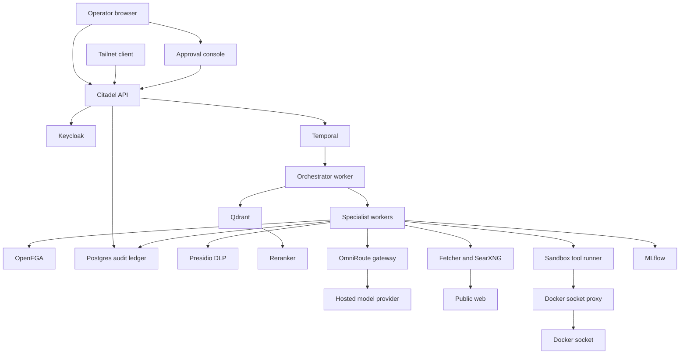

# Citadel threat model

Produced with the `security-threat-model` skill against `master` at `7954f6e`.
Scope is the runtime system in `compose.yaml` and `src/citadel/`; CI, tests and
the design tree are evidence, not in-scope components. Every claim below names
the path it came from. Where a claim is an assumption it is marked as one.

This document does not replace `docs/security/tool-tiers.md` (the control
register) or `docs/security/red-team-pack.md` (the executable cases). It states
what an attacker would try, which control answers it, and what remains.

## 1. System model

Citadel is an agent runtime: a user asks for a DevOps task, an orchestrator
plans, specialist workers call tools, and a human approves anything that writes.
Model inference is hosted and reached only through one egress gateway.

### Runtime components (in scope)

| Component | Responsibility | Evidence |
|---|---|---|
| API | Authenticated ingress, tenant extraction, run creation, approval backend | `src/citadel/api/app.py` (`create_app`), routes `/runs`, `/approvals`, `/policy/authorize` |
| Approval console | Human decision surface for T1 calls | `src/citadel/ui/`, `compose.yaml` `approval-ui` |
| Keycloak | OIDC identity; issues the user token carrying `tenant` | `src/citadel/identity/keycloak.py` |
| Temporal | Durable workflow state, approval wait/resume | `src/citadel/workflows/orchestrator.py`, `src/citadel/workflows/specialist.py` |
| Workers | Orchestrator plus Docker, GitHub and Researcher specialists | `compose.yaml` `worker-*` |
| OpenFGA | Single authorisation store | `src/citadel/policy/openfga.py`, `src/citadel/policy/authorize.py` |
| Postgres | Append-only hash-chained audit, idempotency, RLS tenant data | `src/citadel/audit.py`, `src/citadel/db.py` |
| Presidio | Fail-closed DLP on input, retrieval, tool output and record surfaces | `src/citadel/dlp.py`, `docs/security/secrets.md` |
| Qdrant + reranker | Per-tenant vectors; in-stack cross-encoder | `src/citadel/retrieval/activities.py` |
| OmniRoute | The only path to a hosted provider | `compose.yaml` `omniroute`, ADR-025 |
| SearXNG + fetcher | Untrusted public-web retrieval | `src/citadel/research/`, `docs/security/static-analysis.md` |
| Tool runner | Ephemeral sandbox executing allowlisted argv | `src/citadel/tools/runner.py`, `compose.yaml` `tool-runner` |
| Socket proxy | Read-only Docker surface for T0 inspection | `compose.yaml` `docker-socket-proxy` |
| Operator | The only T1 writer; holds the Docker write path and `gh` | `compose.yaml` `operator`, ADR-023 |

### Out of scope

- CI and build tooling (`.github/workflows/`), tests and fixtures.
- The design docs in `docs/`, except as cited evidence.
- Host-level services outside Compose. Their exposure is tracked separately in
  the deployment findings (#223, #224) and is referenced, not modelled, here.

## 2. Data flow and trust boundaries

### Trust boundaries

| Boundary | Edge | Authentication | Transport | Notes |
|---|---|---|---|---|
| B1 host to stack | published port to a service | per-service (Keycloak, bearer token, or none) | plain HTTP on the host | `compose.yaml` publishes five ports; four on all interfaces |
| B2 user to API | browser to `/runs` | Keycloak JWT, `tenant` claim required | inside the stack | `src/citadel/api/app.py` module docstring, `current_principal` |
| B3 API to workers | Temporal workflow input | signed Ed25519 run token | Temporal | `src/citadel/identity/run_token.py` (`mint_run_token`, `verify_run_token`) |
| B4 worker to policy | `authorize()` | service call, no caller identity beyond the request | internal network | `src/citadel/policy/authorize.py` |
| B5 worker to sandbox | `/execute` | run token, verified with the public key only | internal network | `compose.yaml` `tool-runner` env |
| B6 sandbox to Docker | socket | proxy allowlist, `POST=0` | loopback within stack | `compose.yaml` `docker-socket-proxy` |
| B7 stack to internet | OmniRoute, egress proxy, fetcher | provider key or allowlist | TLS | ADR-020, ADR-023 |
| B8 untrusted web to model | fetcher output | none, by definition | internal | `src/citadel/research/labels.py` |

## 3. Assets

- **Tool authority** — the ability to restart a service or open a PR. The
  highest-value target; all other controls exist to bound it.
- **Audit ledger integrity** — append-only, hash-chained per tenant
  (`src/citadel/audit.py`). A gap here removes the evidence trail.
- **Run-token signing key** — `CITADEL_RUN_TOKEN_PRIVATE_KEY`, a Docker secret
  held by the API. Forging it forges any agent identity.
- **Tenant data in Postgres and Qdrant** — RLS and per-tenant collections.
- **Secret set** — SOPS ciphertext plus the mounted files under `secrets/`
  (`docs/security/secrets.md`).
- **Provider credentials** — held only by OmniRoute. No application component
  holds a provider key (architecture §1).

## 4. Attacker capabilities

Assumed in scope:

- **C1 — LAN peer.** Any host on `172.28.26.0/20` can reach every published
  port. Four of the five are bound to all interfaces (`compose.yaml` 96, 246,
  532, 568), so Keycloak, the API, the approval console and OmniRoute answer a
  LAN peer directly (#219, #221, #222). The owner has since stated that the LAN
  is trusted (A1, 2026-11-27): the capability stands, its abuse paths are
  ranked as accepted risk rather than treated as open exposure.
- **C2 — Anyone who reads a retrieved document, PR body or tool output.** The
  attacker controls text, never code paths: this is the injection surface.
- **C3 — A compromised dependency or model artefact.** Supply-chain attacker.
- **C4 — A local unprivileged user on the host**, given `iptables -P INPUT
  ACCEPT` and passwordless `sudo` (#223): effectively host root.

Explicitly not assumed:

- No inbound internet path exists: the host sits behind NAT with no port
  forward, so "anonymous internet attacker" is not a realistic capability
  today. This is the assumption most likely to change and it is an open
  question below.
- No model-influenced component can read `.env` or the Docker socket by
  design (`compose.yaml` `tool-runner`, ADR-012/ADR-023). Only the operator
  holds the write path, and it never sees model output.

## 5. Abuse paths

| ID | Abuse path | L | I | Priority | Existing control | Evidence | Residual |
|---|---|---|---|---|---|---|---|
| AP1 | LAN peer reaches the Keycloak admin console or the OmniRoute dashboard and attacks a default or reused admin credential | Low | High | Medium | trusted LAN by decision (A1); distinct admin passwords in SOPS | #221, #222; `compose.yaml` 96, 246 | accepted while the LAN is trusted; revisit if a peer stops being trusted or a port is forwarded |
| AP2 | LAN peer calls `/runs` with a forged or stolen user token | Low | High | Medium | Keycloak verification, `tenant` claim required, fail closed | `src/citadel/api/app.py` `current_principal` | token theft is AP3 |
| AP3 | Stolen user token replays a run | Medium | Medium | Medium | short-lived token, run ID, tenant-bound scope, audit | architecture §9; `src/citadel/identity/run_token.py` | no proof-of-possession beyond the bearer |
| AP4 | Injected text in a retrieved chunk steers the agent into a T1 tool call | High | High | **High** | skills carry no authority, `authorize()` denies unknown tools, HITL on T1, DLP on tool output | `src/citadel/policy/authorize.py:104-107`, RT-INJ-02/03/04 | the model can still *propose* the call; a human must approve |
| AP5 | MCP `tools/list` description carries a hijack instruction | Medium | Medium | Medium | name must exist in catalog, fields whitelisted, description digest pinned, description absent from the model's manifest | `src/citadel/tools/registration.py`, `src/citadel/tools/description_pins.json`, RT-INJ-06 | a pinned description that was reviewed badly still passes |
| AP6 | Agent approves its own T1 run | Low | High | Medium | `can_approve` relation, originating agent refused, `actor_type=agent` recorded | `src/citadel/policy/authorize.py:148` (`authorize_approval`), ADR-022 | a second colluding agent is indistinguishable from a reviewer |
| AP7 | Cross-tenant retrieval: a query returns another tenant's chunk | Low | High | Medium | per-tenant collection name, ACL filter applied before search, filter-set digest, cache partition | `src/citadel/retrieval/activities.py` (`collection_name`, `filter_set_hash`), architecture §9 | entitlement mistakes in ingest are not detectable at query time |
| AP8 | Credential in tool output reaches the hosted model | Medium | High | **High** | fail-closed DLP before egress; a credential blocks rather than redacts | `src/citadel/dlp.py`, `docs/security/secrets.md` surfaces table | a detector miss is a silent leak; ADR-025 accepts redacted-text retention |
| AP9 | Sandbox escape via a tool argument | Low | High | Medium | argv list with `shell=False`, metacharacter rejection, read-only rootfs, `cap_drop: ALL`, no socket, socket proxy `POST=0` | ADR-023 items 3-5; `compose.yaml` `tool-runner` | gVisor unavailable on this host (ADR-012), so the container boundary is the kernel boundary |
| AP10 | Local user escalates to root and reads the secret files | Medium | High | Medium | file custody only; `secrets/` is mode 0644 by design | #223; `docs/security/secrets.md` | #223 stays open as a host defect (passwordless `sudo`, `INPUT ACCEPT`); trusting the LAN lowers the likelihood, not the impact |
| AP11 | Cost exhaustion through repeated runs | Medium | Low | Low | `max_steps` 6, `max_tokens` 8000, workflow timeouts, approval TTL | `src/citadel/model/types.py:68-69`, `src/citadel/workflows/orchestrator.py:177`, `src/citadel/ratelimit.py` | closed by #256: a per-credential token bucket charged before the request reaches the database. What remains is in-process state, so a second `api` replica would need a shared store |
| AP12 | Compromised reranker process | Low | Medium | Low | internal-only, no published port | `compose.yaml` `reranker` | runs as root with default caps and no pid/memory limit; the owner confirmed this is an oversight to fix, not an accepted constraint (#227) |

## 6. Mitigations, in order

Ordered after the A1 answer: a trusted LAN moved AP1 and AP10 to Medium, so the
first two items are the ones that survive that decision unchanged.

1. **AP8 — keep DLP in the fail-closed path and test detector failure, not just
   detection.** The existing red-team cases cover the hit; make sure an
   unreachable Presidio blocks the run.
2. **AP4/AP5 — keep the description-digest pin as a review gate.** It is the
   only control that survives a compromised MCP server, and it is cheap to
   regress: add a case where a pinned description is edited.
3. **AP11 — the ingress limiter is in place (#256).** `RunBudget` charges one
   run per `(tenant, user)` before the request reaches the database and refuses
   with 429 plus `Retry-After`. The one thing to keep true: the bucket is
   in-process, so it needs a shared store the day a second `api` replica exists.
4. **AP12 — apply the ADR-012 flag set to the reranker image.** Non-root user,
   `cap_drop: ALL`, `no-new-privileges`, pid and memory limits. Confirmed as a
   fix rather than an accepted upstream constraint; filed as #227.
5. **AP1/AP10 — bind the four published ports to loopback and fix the host.**
   Accepted risk while the LAN is trusted, not dropped: this is the item that
   becomes urgent the moment a peer is untrusted, a port is forwarded, or the
   tailnet-only path is completed. Loopback binds plus `tailscale serve` make
   the tailnet the only remote path; `DOCKER-USER` rules are required because
   Docker DNAT bypasses `ufw`. Tracked as #219 and #223.

## 7. Assumptions and the owner's answers

Assumptions that move the ranking:

- **A1 — The LAN is trusted** (owner decision, 2026-11-27). Every host on
  `172.28.26.0/20` is treated as trusted, so AP1 and AP10 sit at Medium and the
  ranking is dominated by AP4 and AP8. This is the assumption with the largest
  effect on the document: reverse it and AP1 and AP10 return to High and
  mitigation 5 moves to the top.
- **A2 — No inbound internet exposure, and none is planned.** The Cloudflare
  Zero Trust path was decommissioned; the intended remote path is the tailnet.
  If a public hostname returns, a whole boundary reappears with no Access app,
  no device posture and no Gateway policy behind it.
- **A3 — One tenant in practice.** Multi-tenancy is modelled and enforced, but
  AP7's likelihood rises with the second tenant and its first real ACL mistake.
- **A4 — Provider-side retention of DLP-redacted text remains accepted**
  (ADR-025). If that changes, AP8 splits into "credential leak" and "proprietary
  text leak", and the second has no control.

Answers from the owner (2026-11-27), and what each one changed:

1. **Is the LAN trusted for the four `0.0.0.0` services?** Yes. Recorded as A1;
   AP1 and AP10 drop from High to Medium and mitigation 5 is demoted to
   accepted risk rather than open exposure.
2. **Should the API carry its own request budget?** Yes, it should. OmniRoute's
   quota is not the intended control, so the API got its own budget: #256,
   which closes AP11 and moves LLM10 to Covered.
3. **Is the reranker's root user deliberate?** No. It is an oversight, so #227
   is a fix to make rather than a constraint to record.

## 8. Quality check

- Every runtime component named here has a path in §1; nothing is claimed
  without one.
- All eight boundaries in §2 appear in at least one abuse path except B6, which
  is covered by AP9.
- CI, tests and docs are excluded from the model and cited only as evidence.
- The three questions this document raised were put to the owner and answered
  on 2026-11-27; the answers are recorded verbatim in §7 and their consequences
  are applied to §4, §5 and §6 rather than left as commentary.
